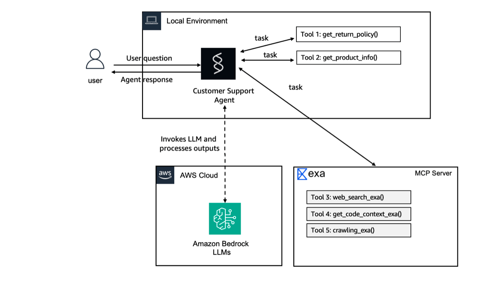
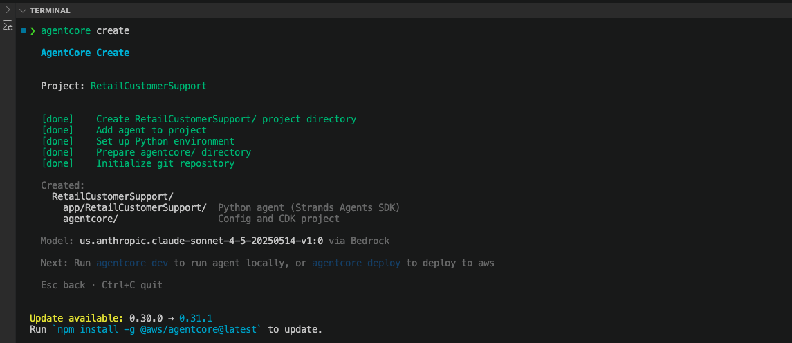
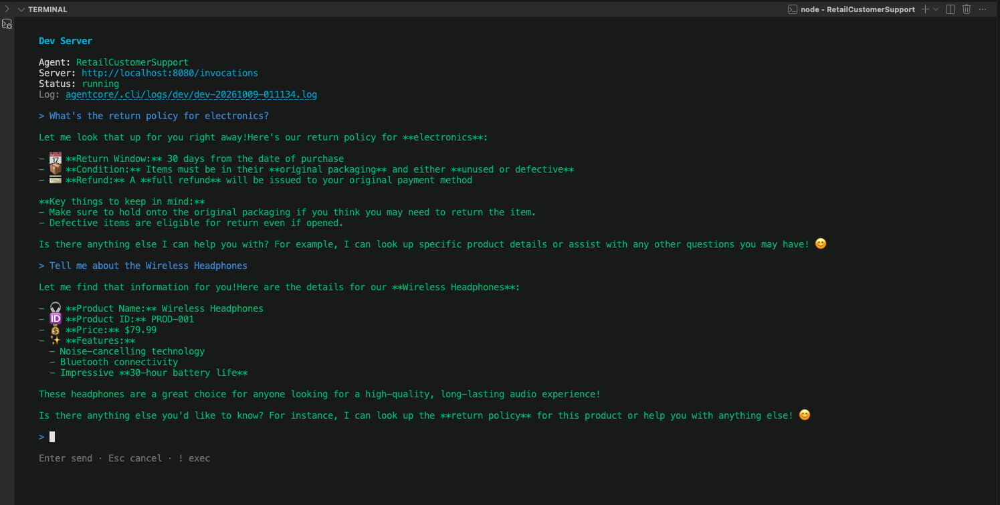
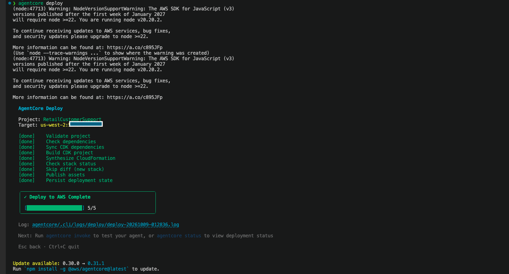
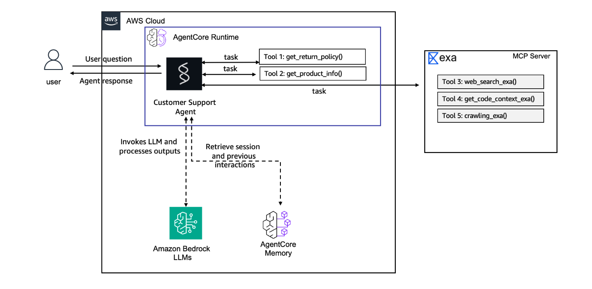
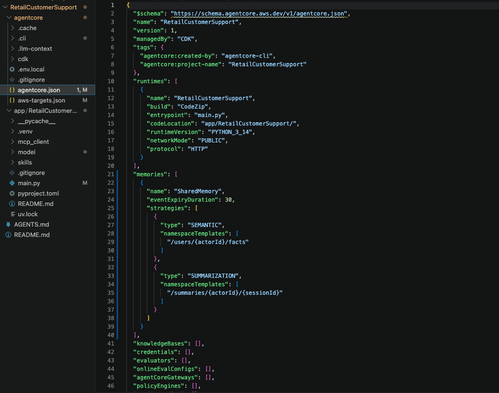
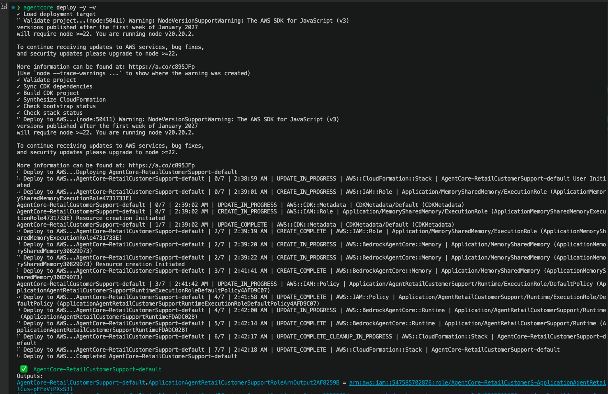
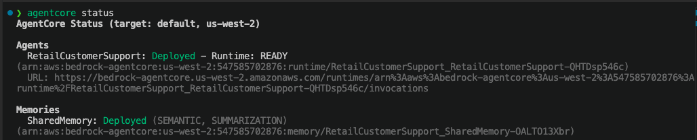
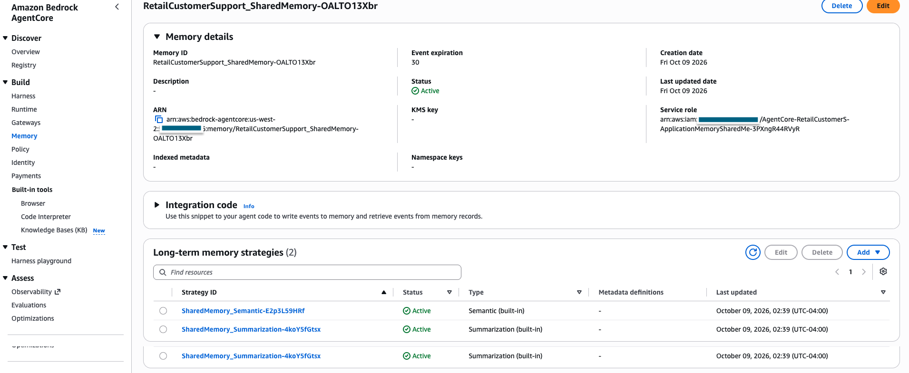
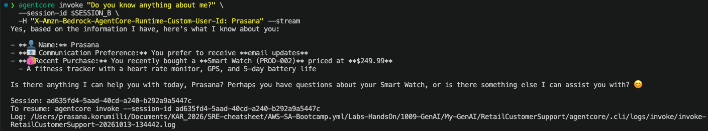

# RetailCustomerSupport

A Python customer-support agent built with the Strands Agents SDK and deployed to Amazon Bedrock AgentCore Runtime. It answers product and return-policy questions, can use an MCP web-search server for broader research, and retains customer context with AgentCore Memory.

`RetailCustomerSupport` documents a hands-on implementation based on the AWS Builder Center's **Getting Started with Amazon Bedrock AgentCore** workshop:

- [Prerequisites: self-paced setup](https://catalog.workshops.aws/agentcore-getting-started/en-US/10-prereqs/12-self-paced)
- [Hands-on 1: Build the agent prototype](https://catalog.workshops.aws/agentcore-getting-started/en-US/20-lab1-agent)
- [Hands-on 2: Add memory to the agent](https://catalog.workshops.aws/agentcore-getting-started/en-US/30-lab2-memory)

The AgentCore CLI is the workflow tool used in this hands-on implementation to scaffold, run, deploy, and manage the application; it is not a separate application dependency. See the [official workshop overview](https://catalog.workshops.aws/agentcore-getting-started/en-US) and [AgentCore CLI](https://github.com/aws/agentcore-cli).

## Architecture

```text
Customer
   │
   ▼
AgentCore Runtime (HTTP)
   │
   ▼
Strands retail-support agent ──► Amazon Bedrock model
   │                │
   │                ├── get_product_info
   │                ├── get_return_policy
   │                ├── Exa MCP web search
   │                └── AgentCore Memory
   │                       ├── short-term session events
   │                       ├── semantic customer facts
   │                       └── conversation summaries
   ▼
Streaming response
```



*Initial local architecture: the agent uses local return-policy and product-information tools, Exa MCP tools, and an Amazon Bedrock model.*

## What this project demonstrates

- A Strands agent hosted by Amazon Bedrock AgentCore Runtime.
- Two Python tools: `get_product_info` and `get_return_policy`.
- A streamable HTTP MCP client for Exa web search.
- A Bedrock-hosted Claude model selected in `app/RetailCustomerSupport/model/load.py`.
- Durable customer context through AgentCore Memory.
- Semantic memory for facts and summarization memory for conversation continuity.

## Prerequisites

The workshop's self-paced setup calls for the following local tools:

- Node.js 20.x or later
- `uv` 0.4 or later for Python environments and dependencies
- AWS CLI v2, authenticated to the AWS account and Region you will use
- Git 2.x or later
- An AWS account with permissions to use Amazon Bedrock and provision the AgentCore resources required by the deployment
- Access to the Bedrock model configured in `app/RetailCustomerSupport/model/load.py`

Install and verify the AgentCore CLI:

```bash
npm install -g @aws/agentcore
agentcore --version
```

Verify the other tools and AWS identity before continuing:

```bash
node --version
uv --version
aws --version
git --version
aws sts get-caller-identity
```

> This hands-on implementation creates billable AWS resources, including Bedrock model invocations and AgentCore Runtime/Memory resources. Follow your organization's cleanup and cost-management practices when you finish.

## Project layout

```text
RetailCustomerSupport/
├── agentcore/
│   ├── agentcore.json                 # Runtime and memory declarations
│   ├── aws-targets.json               # Local deployment target: account and Region
│   └── cdk/                           # CLI-managed deployment infrastructure
└── app/RetailCustomerSupport/
    ├── main.py                        # Agent, tools, MCP client, Runtime entrypoint
    ├── memory/session.py              # AgentCore Memory session-manager setup
    ├── mcp_client/client.py           # Streamable HTTP MCP client
    └── model/load.py                  # Bedrock model configuration
```

## Hands-on implementation

### 1. Create an AgentCore agent

Create the `RetailCustomerSupport` agent with the AgentCore CLI:

```bash
agentcore create \
  --name RetailCustomerSupport \
  --framework Strands \
  --model-provider Bedrock \
  --memory none
```

The CLI creates the Strands application skeleton, `agentcore/` configuration, local Python environment, and CDK deployment project.



*AgentCore CLI scaffolding completed for `RetailCustomerSupport`.*

### 2. Customize the agent with tools and MCP

[`main.py`](app/RetailCustomerSupport/main.py) defines two local `@tool` functions and registers an Exa streamable HTTP MCP client. The local tools ground retail answers in the demo catalog and return-policy data; MCP extends the agent with web search for broader questions.

```python
@tool
def get_return_policy(product_category: str) -> str:
    """Get return-policy details for a product category."""

@tool
def get_product_info(query: str) -> str:
    """Search the demo catalog by product ID, name, or keyword."""

tools = [get_return_policy, get_product_info]
for mcp_client in mcp_clients:
    if mcp_client:
        tools.append(mcp_client)
```

The MCP client is created in [`mcp_client/client.py`](app/RetailCustomerSupport/mcp_client/client.py) and connects to Exa's streamable HTTP MCP endpoint.

### 3. Pin the Amazon Bedrock model

[`model/load.py`](app/RetailCustomerSupport/model/load.py) pins the model used by the agent:

```python
return BedrockModel(model_id="global.anthropic.claude-sonnet-4-6")
```

The initial creation screenshot shows the workshop's Claude Sonnet 4.5 default. The checked-in implementation currently uses the global Claude Sonnet 4.6 model ID shown above.

### 4. Start and test the local development server

Run the local AgentCore development server without opening the browser interface:

```bash
agentcore dev --no-browser
```

Use the terminal UI to test return-policy and product-information questions before deploying.



*Local validation of the return-policy and product-information tools.*

### 5. Deploy the agent to AWS

Review `agentcore/aws-targets.json`, then deploy the CodeZip runtime:

```bash
agentcore deploy
```



*AgentCore deployment completed successfully. The account-specific target value is redacted.*

### 6. Add AgentCore Memory

Add a shared memory resource with semantic-fact and conversation-summary strategies. The 30-day expiry controls retention of short-term memory events.

```bash
agentcore add memory \
  --name SharedMemory \
  --strategies SEMANTIC,SUMMARIZATION \
  --expiry 30
```



*Expanded architecture: AgentCore Memory adds retrieval of customer facts and prior-session context alongside the runtime, model, local tools, and MCP server.*

### 7. Review the generated memory configuration

The CLI adds a `SharedMemory` declaration to [`agentcore/agentcore.json`](agentcore/agentcore.json), with semantic facts and session summaries stored under these namespaces:

```text
/users/{actorId}/facts                 semantic customer facts
/summaries/{actorId}/{sessionId}       conversation summaries
```



*Memory configuration declared in `agentcore.json`.*

### 8. Wire memory to the agent code

[`memory/session.py`](app/RetailCustomerSupport/memory/session.py) reads the deployed memory ID, configures retrieval namespaces, and returns an `AgentCoreMemorySessionManager`. [`main.py`](app/RetailCustomerSupport/main.py) passes that session manager when creating the Strands agent:

```python
Agent(
    model=load_model(),
    session_manager=get_memory_session_manager(session_id, user_id),
    system_prompt=SYSTEM_PROMPT,
    tools=tools,
)
```

### 9. Deploy the memory-enabled agent and validate recall

Deploy the updated configuration with automatic confirmation and verbose resource events:

```bash
agentcore deploy -y -v
```



*Verbose deployment output confirms that AgentCore provisions the memory resource and updates the runtime.*

Check the deployed runtime and memory resource status:

```bash
agentcore status
```



*AgentCore status confirms that both the runtime and `SharedMemory` are deployed.*



*AgentCore console confirmation that the deployed memory resource is active with both long-term memory strategies.*

To validate durable memory, invoke the agent in a second session with the same user ID. The second session retrieves facts established in the first, proving recall comes from AgentCore Memory rather than only the in-process conversation context.



*Cross-session memory validation: the same user ID is recognized in a new session and the agent retrieves retained customer facts.*

## Security and repository hygiene

- Never commit AWS access keys, API keys, tokens, or `agentcore/.env.local`.
- Treat `agentcore/aws-targets.json` as environment-specific because it contains an AWS account ID. For a public portfolio, publish a sanitized example file and keep the real target file local.
- Review `git diff --cached` before each commit.
- Do not use production customer data in tool fixtures, prompts, memory-validation inputs, screenshots, or documentation.

## Next steps

The hands-on sequence continues with AgentCore Gateway, security and observability, evaluation, a customer interface, and policy-based governance. Good next enhancements for `RetailCustomerSupport` are an order-status integration backed by authenticated data, evaluation cases, observability dashboards, and a web chat interface.
